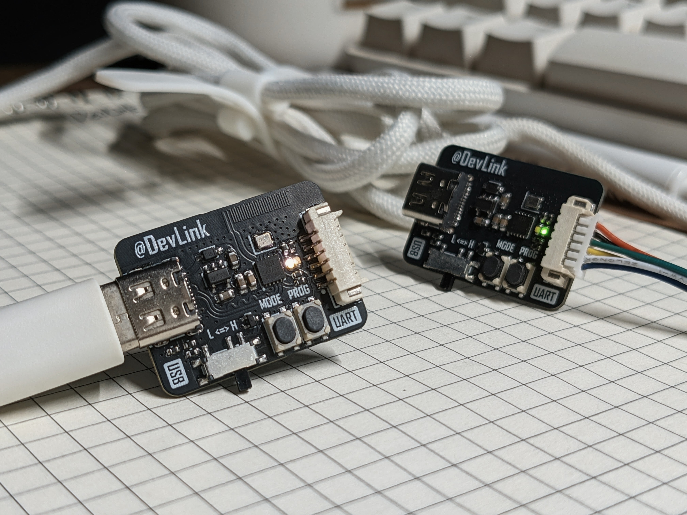
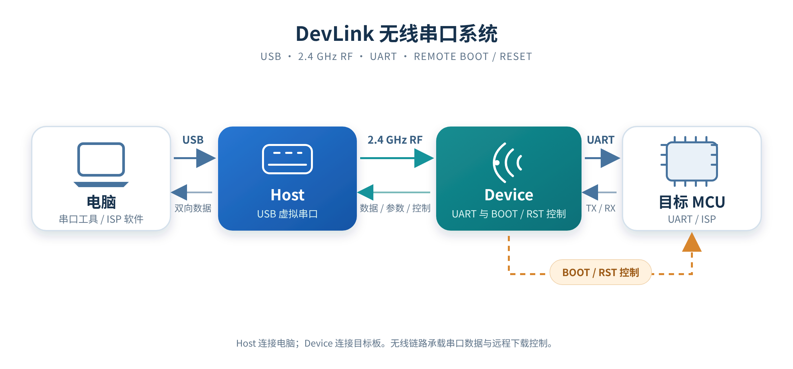
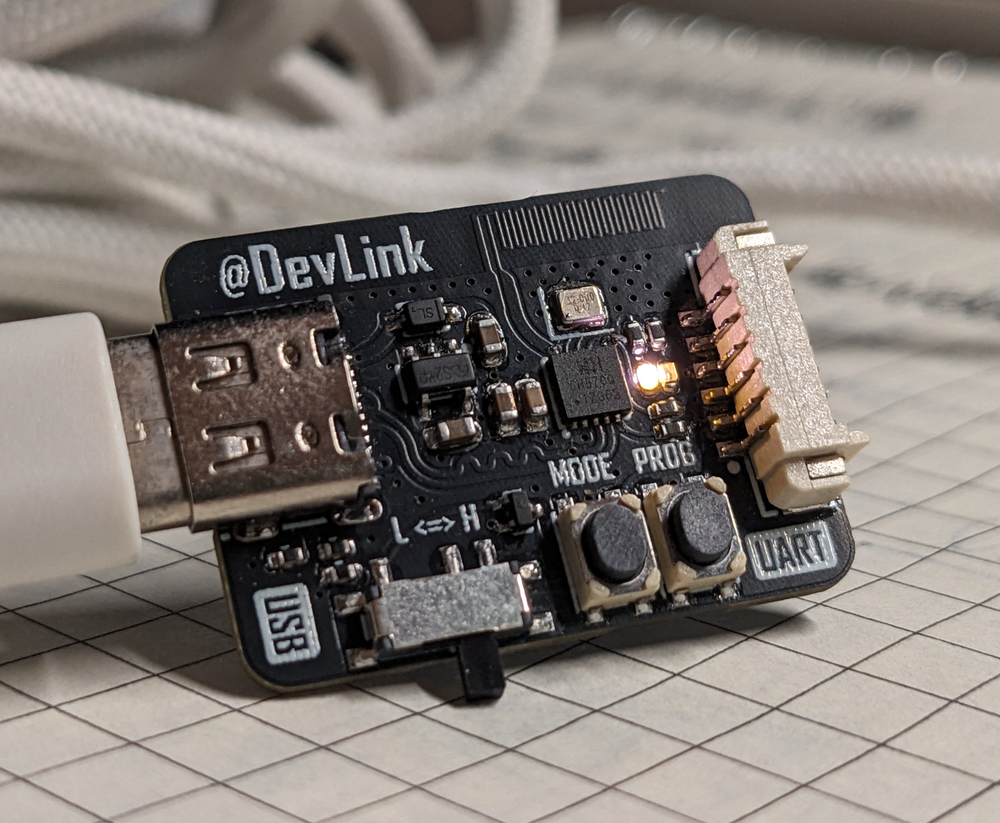
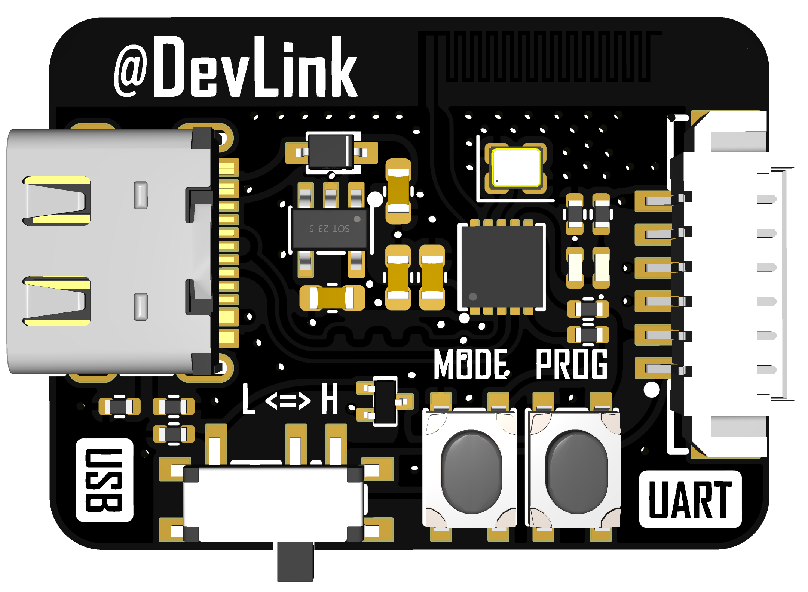
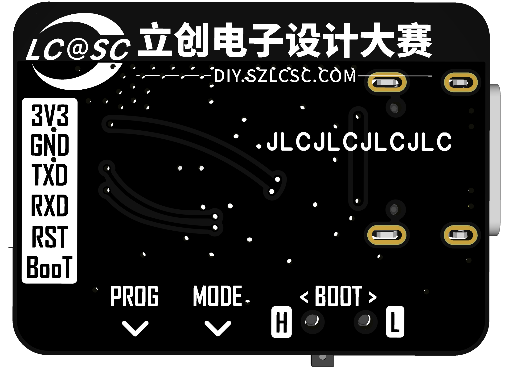
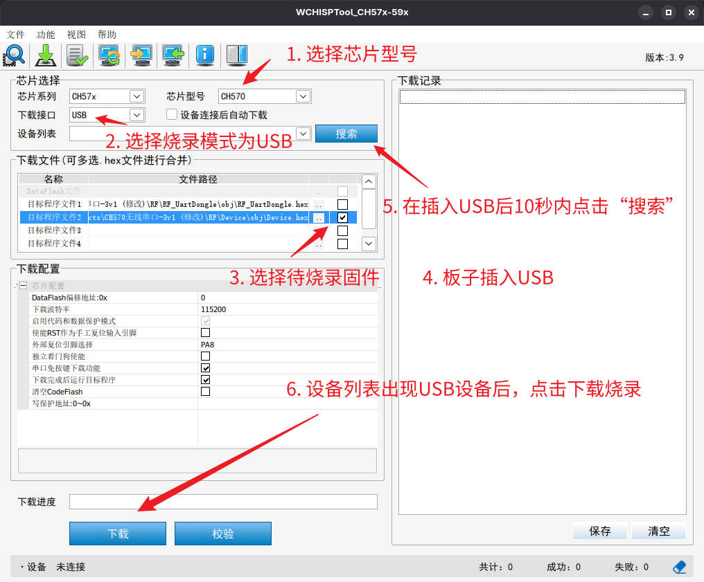
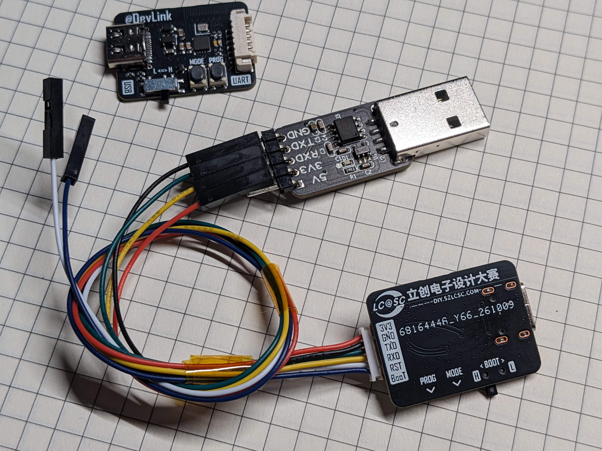
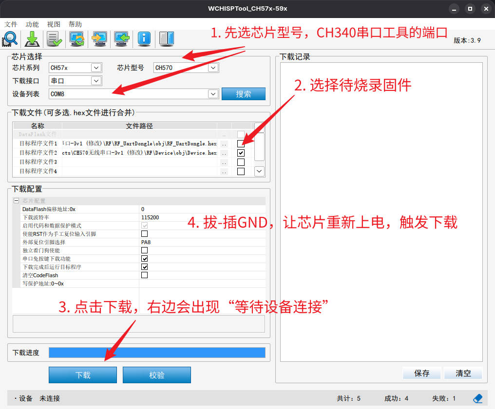

# DevLink

<p align="center">
  基于WCH CH570Q的无线串口/烧录工具
</p>

<p align="center">
  
  
  
  
  
</p>

DevLink使用两颗WCH CH570Q搭建无线串口链路：
Host通过USB连接电脑，Device通过UART连接目标MCU，两端以 2.4GHz RF传输串口数据。Host还可以请求Device控制目标MCU的BOOT和RST，配合支持的ISP工具进行远程下载。

<p align="center">
  
</p>

<br>

## 项目链接

项目仓库：[Github: sleep4at/DevLink](https://github.com/sleep4at/DevLink)


<br>


## 功能特性

- **无线串口桥接**：电脑与目标MCU双向收发串口数据，Host将串口配置同步到Device。
- **远程BOOT/RESET控制**：Host发起下载请求，Device按配置好的时序控制目标MCU；外部可调的BOOT电平输出；适用STM32 Bootloader的场景会发送同步字节 `0x7F`。
- **接收反压与重传保护**：接收端反馈可用额度，缓冲区不足时拒绝确认，降低拥塞时静默丢包的风险。
- **Self-Boot**：Host、Device都可通过PROG按键进入各自的ROM ISP；此操作会擦除启动区，让下次上电直接进入ISP模式，方便使用USB烧录新固件。
- **双LED状态显示**：指示配对、角色、数据活动及Self-Boot确认状态。

<br>

## 系统结构

<p align="center">
  
</p>


Host负责USB与电脑连接；Device负责目标MCU的串口及BOOT/RESET控制。

数据从电脑发出后，依次经过Host USB、RF链路和Device UART到达目标MCU；反向数据按相反方向返回。串口波特率等配置也会从Host同步到Device。

接收端会报告可接收额度，缓冲区不足时通过拒绝确认促使发送端重试。

<br>
<p align="center">
  
  <!--  -->
</p>
<br>


## 引脚功能配置及使用说明

| 端 | 引脚 | 用途 |
|:--|:--|:--|
| Host | PA7 (MODE) | 请求远程下载，由Device控制目标MCU，空闲时为上拉输入 |
| Host | PA2 (PROG) | 本机进入CH570 ROM ISP，空闲时为上拉输入 |
| Device | PA0 / PA1 | 目标UART TX / RX |
| Device | PA2 (PROG) | 本机ISP确认键，同时连接目标NRST，空闲时为上拉输入 |
| Device | PA7 | 目标BOOT控制，空闲时为高阻 (MODE按键未使用) |
| 两端 | PA3 | 双LED状态指示 |

### BOOT输出电平切换

因不同MCU的BOOT有效电平不一致，故在板上有放置拨动开关，由拨动开关切换PA7实际输出电平，以适配不同MCU。L为输出低电平，H为输出高电平。

### Self-Boot功能

用于Host/Device进入自身ISP模式。Self-Boot功能采用两步确认：首次按住PROG按键 3 秒后，两颗LED交替闪烁并进入 5 秒窗口；<br>
窗口内再次按住PROG按键 1 秒后，Device角色灯快闪，松开会擦除`0x0000`起始的4KiB boot stub区，并在下次上电直接进入ROM ISP。超时或确认不足会取消操作，恢复正常运行不复位。

### 双LED指示

用于指示设备运行状态。<br>
未配对时，角色灯闪烁；<br>
配对后对应角色灯单灯常亮，数据活动时双闪指示灯；<br>
本机ISP确认时，第一次进入窗口期时双LED交替闪烁；第二次确认阶段快闪角色灯。

<br>
<p align="center">
  
  
</p>
<br>

## 使用流程

1. 分别为Host和Device烧录对应固件；两端上电后首次配对需要互相靠近距离 10cm 以内才能配对，待各自LED常亮后说明配对成功。配对成功后会写入flash保存配对信息，后续上电无需靠近配对。
2. Host插入电脑，确认系统出现CH340 兼容串口；Device的TX/RX与目标MCU UART交叉连接，并共地。
3. 在串口软件中选择Host对应的串口，设置与目标MCU一致的波特率和数据格式，即可双向收发。
4. 需要远程进入目标MCU下载模式时，先确定Device的BOOT开关档位是否与目标MCU的BOOT有效电平一致，再按Host的MODE键请求下载。<br>
当Device收到下载命令后，BOOT输出高/低电平；约 50 ms后RST拉低并保持约 50 ms；随后RST恢复内部上拉，BOOT继续保持高/低电平约 100 ms；最后BOOT恢复高阻。

<br>

## 编译与烧录

工程使用WCH MounRiver Studio和项目配置的RISC-V工具链。分别打开并构建：

- `RF/Host/Host.wvproj`：Host固件
- `RF/Device/Device.wvproj`：Device固件

构建产物位于各工程的 `obj/` 目录。

> [!NOTE]
> **烧录需要芯片处于ROM ISP模式下，空片无程序上电默认进入ROM ISP，二次烧录需要使用PROG按键进入ROM ISP。**

<br>

### USB烧录（推荐）

ROM ISP中，USB枚举时间为10s，需要在USB上电后10s内触发下载。

<p align="left">
  
</p>

<br>

###  串口烧录

需要一个串口烧录器（CH340），接线如下：

```
3V3 <=> 3V3
TXD <=> TXD
RXD <=> RXD
GND <=> GND
```

<p align="left">
  
</p>

<p align="left">
  
</p>

<br>

<!-- ### 命令行烧录

进入相应 `obj/` 目录后，烧录对应工程生成的完整HEX，例如：

```bash
# USB烧录，运行后有15s下载窗口
wchisp -u -r 15 flash Host.hex
# or
# 串口烧录
wchisp -s -p /dev/ttyUSBx -b Baud115200 flash Device.hex
``` -->


## 常见问题

> 遇到问题无法烧录或设备无法正常工作，优先检查接线和焊接~

### 1. USB烧录无反应或显示未知设备

- 烧录前，确认当前设备芯片处于空片或无启动分区状态。<br>
- 如果6P接口插着杜邦线，杜邦线另一端不要插任何设备或单片机，因为串口与USB共用一组IO，会影响USB通信。<br>
- 最好将1.27转2.54杜邦线拔除再尝试USB烧录。<br>
- 有些tb商家卖的芯片可能带程序，只能尝试使用串口免按键烧录，烧录时勾选“清空Codeflash”。<br>

### 2. Linux无法枚举USB或打开串口提示“输入/输出错误”

Host正常运行时使用CH341兼容USB接口，Linux通常由内核 `ch341` 驱动创建 `/dev/ttyUSB*`。<br>
若设备已枚举但打开串口超时或报I/O错误，检查USB自动挂起设置：为VID:PID `1a86:7523` 配置 `power/control=on`；使用TLP时也将该设备加入USB自动挂起黑名单。<br><br>
<!-- 详细说明见 [Linux USB适配说明](RF/LINUX_USB_FIX.md)。 -->
<!-- 建议使用 `/dev/serial/by-id/` 下的设备路径，避免插拔后 `/dev/ttyUSB*` 编号变化。 -->

*待发现......*

<br>

## 参考工程

- 第11届立创电赛官方代码
- Self-Boot功能参考 [Golden_nianhua/WCH-Serial-Tool](https://github.com/Golden-nianhua/WCH-Serial-Tool/tree/main/software/ch570q_firmware)
<!-- - Self-Boot功能参考 [
WCH无线双串口@golden_nianhua](https://oshwhub.com/golden_nianhua/project_rgrwozlf) -->
