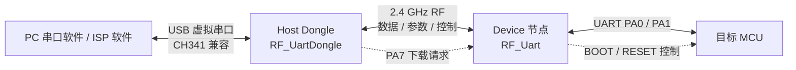
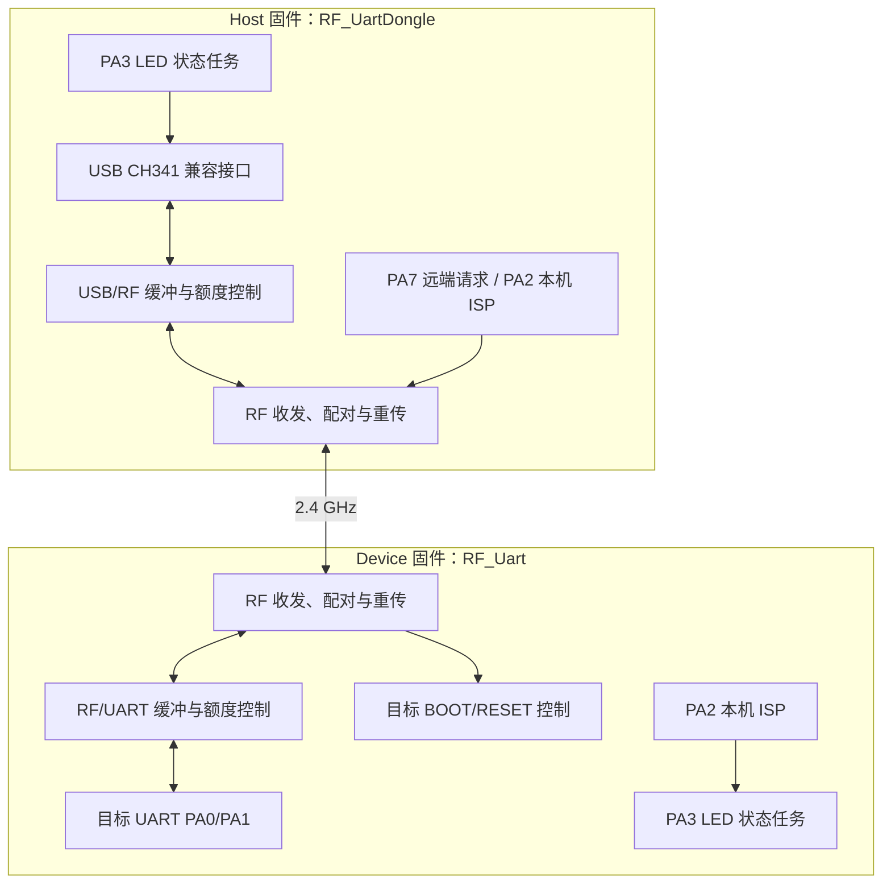

# CH570 无线串口与远程 ISP 辅助工具

<p align="center">
  <strong>让 USB 串口跨越无线链路，也让目标 MCU 的下载控制触手可及</strong><br>
  基于 WCH CH570 的 Host / Device 双固件无线串口与 BOOT/RESET 控制方案
</p>

<p align="center">
  
  
  
  
</p>

> 本文用于项目展示、方案说明与后续补充。图片占位符可替换为实物照片、原理图、逻辑分析仪截图或软件界面截图。

---

## 项目速览

| 项目项 | 内容 |
|:--|:--|
| 项目名称 | CH570 无线串口与远程 ISP 辅助工具 |
| 项目类型 | 嵌入式通信工具 / 无线串口桥 / MCU 下载辅助 |
| 核心器件 | WCH CH570 |
| 系统组成 | Host USB Dongle、Device UART 节点、目标 MCU、PC 串口软件 |
| 无线链路 | CH570 2.4 GHz RF |
| 固件形式 | Host 与 Device 两份互斥的单角色固件，分别编译、分别烧录 |
| 适用场景 | 无线串口调试、远端 MCU 通信、支持外部 BOOT/RESET 控制的 ISP 辅助 |

### 封面与实物图

> **图片占位：项目封面 / 两端设备合照**  
> 建议使用横向实物图，展示 Host Dongle、Device 节点、目标 MCU 板及连接关系。  
> 可将图片保存为 `docs/images/project-cover.jpg`，并替换下方占位。

```text
┌──────────────────────────────────────────────────────────────────────┐
│                                                                      │
│                   在此插入项目封面或设备实物照片                     │
│                                                                      │
│                 Host Dongle  ·  Device  ·  Target MCU                │
│                                                                      │
└──────────────────────────────────────────────────────────────────────┘
```

---

## 1. 项目功能介绍

### 1.1 项目要解决的问题

常见 MCU 调试和烧录需要 PC 与目标板之间有线连接；当目标设备安装位置受限、需要远距离操作，或希望保留现有串口工具和 ISP 软件时，反复布线会影响调试效率。本项目把 PC 侧 USB 虚拟串口通过 2.4 GHz 无线链路延伸至目标板侧，并增加远端 BOOT/RESET 控制，让串口通信和部分 MCU 的 ROM ISP 流程可以无线触发。

### 1.2 核心功能

- **无线串口桥接：** PC 通过 Host 的 CH341 兼容 USB 虚拟串口收发数据；Device 将数据转发到目标 MCU UART，反向数据也经 RF 返回 Host。
- **串口参数同步：** Host 收到 PC 串口软件的波特率、数据格式等配置后，通过无线链路通知 Device 配置目标 UART。默认配置为 115200 baud、8N1、无流控。
- **远端 BOOT/RESET 控制：** Host 按键发出下载请求；Device 收到后按板级电路要求驱动目标 MCU 的 BOOT/RESET，并在适用时发送 STM32 USART ROM Bootloader 同步字节 `0x7F`。
- **缓冲区反压与重传保护：** 使用接收端可用额度限制发送，并在接收缓冲不足时拒绝确认，让发送端按原机制重传，降低缓冲区满导致的静默丢包风险。
- **本机进入 CH570 ROM ISP：** Host、Device 均提供 PA2 长按确认入口。该操作会擦除启动区域并复位，不是普通复位键；恢复时需要重新烧录完整固件。
- **状态灯提示：** 双 LED 显示配对状态、角色状态、数据活动及本机 ISP 操作确认状态。

### 1.3 系统结构



### 1.4 官方基础与本项目拓展

本工程以 WCH CH570 官方无线串口示例为基础，保留官方 RF 配对、无线 PHY、基本串口转发和 Host USB 厂商兼容串口框架。项目不是对某一未提供的竞赛任务书进行逐条验收，因此不能据此宣称已复现某竞赛的全部基础功能；如用于指定赛题，请按赛题指标补充实测结果和对应关系。

在原有基础上的主要适配与拓展包括：

1. 整理为 Host 与 Device 两份分立固件，减少未运行角色的业务路径参与运行；
2. 增加 Host 至 Device 的远端下载触发与目标 BOOT/RESET 时序；
3. 为本机 ROM ISP 提供长按确认入口，并为 Host boot stub 与应用布局配套；
4. 增加 RF 接收额度、缓冲区反压和拒收重传保护；
5. 根据板上双 LED 和按键接线调整 GPIO 分工；
6. 对 Host USB 的 CH341 兼容路径进行 Linux 稳定性处理，并记录 Linux USB 自动挂起的系统侧规避方法。

> **图片占位：项目功能演示**  
> 建议放置串口双向通信截图、无线触发目标 MCU 进入 ISP 的逻辑分析仪波形，以及 Linux `lsusb` / 串口设备识别截图。

---

## 2. 项目属性

### 2.1 项目定位

本项目属于基于官方芯片示例工程进行二次开发和硬件适配的嵌入式工具项目。无线串口基础能力和部分底层驱动来自 WCH 官方示例；本项目的工作重点是围绕实际板卡完成角色固件整理、按键与 LED 适配、远端 BOOT/RESET 控制、缓冲区保护和 Linux 使用说明。

### 2.2 原创性与公开情况

| 说明项 | 当前可确认内容 / 待补充 |
|:--|:--|
| 是否首次公开 | **待项目作者确认**：请填写首次公开平台、日期，或注明“尚未公开” |
| 拓展部分是否原创 | 基于官方示例的二次开发；请由作者确认具体原创范围。不可将官方已有的底层能力表述为独立原创 |
| 是否参加过其他比赛 | **待项目作者填写**：如未参加，请写“未参加” |
| 是否获奖 | **待项目作者填写**：如获奖，注明赛事名称、奖项、年份；如无，请写“无” |
| 是否参加学校答辩 | **待项目作者填写**：如有，填写学校、时间及答辩情况；如无，请写“未参加” |
| 赛题关系 | **待项目作者填写**：如确为指定赛题复刻，请补充赛题名称、主办方和基础指标；否则描述为开源工程二次开发项目 |

---

## 3. 开源协议

### 3.1 当前代码来源与协议说明

本仓库包含 WCH 官方 CH570 示例工程及外设库的修改版本，部分源文件保留原版权声明。项目发布时应同时遵循上游代码所适用的许可、芯片厂商使用条款及第三方代码要求。

**当前不在本文中擅自宣称整个仓库采用 GPL-3.0 或其他单一协议。** 在仓库根目录添加统一 `LICENSE` 前，应先核对官方 SDK/示例的授权范围，并区分原创代码与上游代码。若上游许可不允许重新许可，应保留原始声明，并明确标出新增部分适用的协议。

### 3.2 发布前建议确认

- [ ] 核对 WCH SDK、官方示例及外部库的许可/使用条款；
- [ ] 在源码中保留上游版权与许可声明；
- [ ] 确认新增代码适用的协议及是否允许与上游代码共同发布；
- [ ] 在仓库根目录添加与实际授权一致的 `LICENSE` 文件；
- [ ] 在本节注明代码、原理图、PCB、图片分别适用的协议（若不同）。

> **协议状态：待作者核实并填写。** 公开仓库前建议完成法律与上游许可核对。

---

## 4. 硬件部分

### 4.1 硬件组成

系统由两块 CH570 节点构成：

| 节点 | 主要连接 | 作用 |
|:--|:--|:--|
| Host | PC USB | 提供 CH341 兼容虚拟串口；处理 PC 数据、串口参数及远端下载请求 |
| Device | 目标 UART、BOOT、RESET | 负责无线数据与目标 UART 双向转发，并按请求控制目标 MCU 启动脚 |

### 4.2 当前板级引脚分配

#### Host（`RF_UartDongle`）

| 引脚 | 当前用途 | 电气/操作说明 |
|:--|:--|:--|
| PA0/PA1 | PC USB 虚拟串口 | 正常应用固件使用 CH341 兼容 Vendor 模式，VID:PID 为 `1A86:7523` |
| PA7 | 远端下载请求键 | 按键接地触发，请求 Device 控制目标 MCU BOOT/RESET |
| PA2 | Host 本机 ROM ISP 键 | 按住约 3 秒进入确认闪烁，松开后执行擦除并复位；短按不应视为普通复位 |
| PA3 | 双 LED 指示 | Host 角色灯由高电平点亮；高阻时两灯熄灭 |

#### Device（`RF_Uart`）

| 引脚 | 当前用途 | 电气/操作说明 |
|:--|:--|:--|
| PA0 | UART TX | 接目标 MCU RX |
| PA1 | UART RX | 接目标 MCU TX；注意目标板空闲电平、共地及信号完整性 |
| PA2 | 目标 NRST + Device 本机 ROM ISP 键 | 按键接地；先长按 3 秒，PA3 双闪后进入 5 秒确认窗口；窗口内再长按 1 秒并松开才擦除。因与 NRST 共用，按下期间目标 MCU 也会复位 |
| PA7 | 目标 BOOT 控制 | 空闲为无上拉高阻；远端下载时才临时驱动，板上 NMOS/开关电路负责目标极性适配 |
| PA3 | 双 LED 指示 | Device 角色灯由低电平点亮；高阻时两灯熄灭 |

### 4.3 BOOT/RESET 的目标适配

目标 MCU 的 BOOT 有效电平、复位有效电平及上电采样时序由目标芯片和板级电路决定。本固件执行的是预先约定的 GPIO 时序，不会自动识别目标 MCU 型号或 BOOT 极性。使用前应确认：

- 目标 MCU NRST 的有效电平以及外部/内部上拉情况；
- 目标 MCU BOOT 的有效电平以及外部/内部上拉情况及Device板的开关状态（L或H）；
- 双方共地，且不存在两个推挽输出互相对打；
- 目标 ROM ISP 协议与所用烧录工具相匹配。

`0x7F` 是 STM32 USART ROM Bootloader 常用的同步字符，不是通用 MCU 下载码。其他 MCU 是否支持由串口触发 ROM ISP，取决于芯片 ROM 协议和启动引脚配置。

### 4.4 原理图、实物与调试图片

> **图片占位：硬件连接框图 / 原理图**  
> 建议标注 Host、Device、目标 MCU、USB、UART、BOOT、NRST、按键和双 LED 的连接关系。

```text
[在此插入嘉立创 EDA 原理图截图或硬件连接示意图]
```

> **图片占位：实物接线 / PCB 正反面**

```text
[在此插入 Host 与 Device 实物图、PCB 正反面或目标板接线图]
```

> **图片占位：逻辑分析仪波形**  
> 推荐展示远端进入下载模式时 BOOT、NRST、UART TX 的相对时序，并标注时间刻度。

### 4.5 硬件测试建议

1. **USB 枚举：** 检查 Host 在正常应用下是否枚举为 CH341 兼容串口；Linux 下确认内核绑定 `ch341` 驱动。
2. **UART 电平：** 先用低波特率和短线确认 TX/RX 交叉连接、共地、空闲高电平和波特率一致。
3. **双向数据：** 分别单向、双向发送带序号数据，确认无回环接线、乱码或持续丢包。
4. **远端下载时序：** 用逻辑分析仪观察 BOOT、NRST、UART TX；先验证电平，再连接真实目标芯片。
5. **本机 ISP：** 仅在已准备好恢复烧录方式、HEX 和 USB ISP 工具后测试；擦除动作会破坏启动区域。

---

## 5. 软件部分

### 5.1 固件模块



### 5.2 关键数据流程

#### PC 到目标 MCU

```text
PC 串口软件
    → USB OUT
    → Host USB 缓冲区
    → Host RF 数据包
    → Device RF 接收与缓冲
    → Device UART TX（PA0）
    → 目标 MCU RX
```

#### 目标 MCU 到 PC

```text
目标 MCU TX
    → Device UART RX（PA1）
    → Device RF 数据包
    → Host RF 接收与缓冲
    → USB IN
    → PC 串口软件
```

发送端根据接收端的可用额度控制取数；额度不足时暂停或缩小单包数据。若接收端不能完整接收数据包，会拒绝确认，让发送端按协议重试。该机制能缓解突发流量和队列暂时拥塞，但缓冲区容量有限，目标 UART 又没有硬件流控，不能承诺在任意持续输入、干扰或断电条件下绝对不丢数据。

#### 远端下载控制

```text
Host PA7 按键
    → Host 记录下载请求
    → RF 控制位传给 Device
    → Device 在主循环执行 BOOT/RESET 脉冲
    → 适用 STM32 USART ROM Bootloader 时发送 0x7F
    → PC ISP 软件继续握手和烧录
```

### 5.3 源码结构

| 路径 | 内容 |
|:--|:--|
| `RF/RF_UartDongle/` | Host 工程：USB Vendor/CH341 兼容串口、RF、Host 按键与 LED、自引导 stub |
| `RF/RF_Uart/` | Device 工程：目标 UART、RF、BOOT/RESET 控制、Device 按键与 LED |
| `RF/RF_UartCombo/` | 旧组合工程；当前建议使用分立 Host/Device 工程 |
| `SRC/StdPeriphDriver/` | CH57x 外设驱动与头文件 |
| `RF/LIB/` | RF 库接口与相关文件 |
| `RF/SINGLE_ROLE.md` | 当前角色、引脚、缓冲区和数据保护说明 |
| `RF/CHANGES_FROM_OFFICIAL.md` | 相对官方示例的修改记录 |
| `RF/LINUX_USB_FIX.md` | Linux USB/CH341 适配与自动挂起说明 |

### 5.4 构建与烧录

- **IDE/工具链：** 工程为 WCH MounRiver Studio 工程，使用项目配置的 WCH RISC-V 工具链；命令行环境应使用与工程兼容的 `riscv-none-embed-gcc` 工具链及链接脚本。
- **编译：** 分别打开并构建 `RF/RF_UartDongle/RF_UartDongle.wvproj` 和 `RF/RF_Uart/RF_Uart.wvproj`。
- **产物：** 通常在各工程的 `obj/` 目录下生成 HEX/ELF 等文件；请以实际工程配置为准。
- **烧录：** Host 与 Device 必须烧录各自对应的 HEX，禁止互换。Host 镜像包含 boot stub 与应用布局，发布完整镜像时不可只截取应用区。
- **ISP 恢复：** 擦除启动区域后，ROM ISP 入口与等待时间由芯片 ROM Bootloader 决定；烧录时需在 ISP 枚举窗口内连接工具，超时后可重新按板级流程进入 ISP。

示例命令（请根据实际生成文件路径调整）：

```bash
wchisp -u -r 15 flash RF_UartDongle.hex
wchisp -u -r 15 flash RF_Uart.hex
```

### 5.5 缓冲区与性能边界

当前文档记录的主要缓冲区配置如下，若后续代码发生变化，应以源码宏定义和最新构建报告为准：

| 缓冲区 | 记录容量 | 用途 |
|:--|--:|:--|
| Device 目标 UART 环形缓冲区 | 3 KiB | 暂存 UART 接收数据，等待 RF 发送 |
| Device RF 缓冲区 | 512 B | RF 收发暂存 |
| Host USB 输入缓冲区 | 512 B | 暂存 PC 发往 Device 的数据 |
| Host RF 接收环形缓冲区 | 1 KiB | 暂存 Device 发往 Host 的 RF 数据 |
| RF DMA 接收区 | 264 B | 硬件 RF 接收缓冲，大小受例程/驱动约束 |

历史实测曾在特定设备、距离及环境下以 1 Mbaud 获得约 17.87 KB/s 接收速率且未观察到丢字节。该结果仅是一次测试参考，并非所有环境下的吞吐保证。更高 UART 波特率还受 CH570 UART 分频精度、系统时钟切换、USB 服务时序、无线有效吞吐、缓存余量和目标 MCU 能力共同限制；请用实际波形和序号数据测试，不要仅以 PC 串口软件显示的波特率作为链路能力结论。

### 5.6 Linux 使用注意

Host 正常应用固件使用 CH341 兼容 USB Vendor 模式。Linux 常见串口设备为 `/dev/ttyUSB*`，建议使用稳定的 `/dev/serial/by-id/` 路径。若出现枚举正常但打开端口超时或 I/O 错误：

- 检查 USB runtime autosuspend 是否将设备设为 `suspended`；
- 使用 udev 规则将 `1a86:7523` 的 `power/control` 设为 `on`；
- 如安装 TLP，将该 VID:PID 加入 USB autosuspend denylist；
- 具体命令与验证方式见 [Linux USB 说明](RF/LINUX_USB_FIX.md)。

该项问题可能来自 Linux 主机电源管理策略；不要据此直接修改 Windows USB 兼容路径。

---

## 测试记录与结果展示

请将以下待填项替换为实际测试数据，未测项目不要标记为“通过”。

| 测试项 | 测试条件 | 结果 |
|:--|:--|:--|
| USB 枚举及串口打开 | OS、内核、USB 拓扑、固件版本 | 待填写 |
| UART 双向通信 | 波特率、数据长度、测试时长 | 待填写 |
| 丢包/数据完整性 | 序号格式、包数、统计方法 | 待填写 |
| 无线距离与环境 | 视距/遮挡、干扰源、天线与摆放 | 待填写 |
| 远端 BOOT/RESET | 目标 MCU 型号、波形、ISP 工具 | 待填写 |
| 连续烧录 | 固件大小、成功次数、校验结果 | 待填写 |

> **图片占位：测试截图 / 波形 / 结果统计**  
> 可加入串口收发截图、长时间序号测试统计、无线距离测试现场及烧录成功截图。

```text
[在此插入测试结果图 1]        [在此插入测试结果图 2]
```

---

## 风险提示

1. **本机 ISP 按键会擦除 Flash 启动区域。** 请先准备完整 HEX、可用 USB ISP 方式和恢复步骤；按键并非无损“软跳转”。
2. **BOOT/RESET 时序与目标芯片相关。** 必须核实目标 MCU 的启动配置、电平极性和 ROM ISP 协议。
3. **`0x7F` 不通用于所有 MCU。** 它是 STM32 USART ROM Bootloader 常用同步字节。
4. **无线链路不是无限缓存。** 持续输入超过缓冲能力、无线重试耗尽、断电或严重干扰时仍可能中断或丢数据。
5. **高波特率需实测。** UART 标称配置不等于 RF 实际净吞吐；需同时验证 PC、CH570、目标 MCU 三端参数。
6. **许可证需确认。** 官方示例和外设库的源代码声明应保留，统一开源协议应在核实上游许可后再确定。

---

## 后续可补充

- [ ] 项目实物封面、硬件连接图和 PCB 图片；
- [ ] 赛题名称、主办方与基础功能逐项对照（仅在确有赛题时填写）；
- [ ] 首次公开时间、比赛/获奖/答辩信息；
- [ ] 实际测试环境、最大稳定波特率、距离及长时间丢包统计；
- [ ] 核实上游许可并添加适用的 `LICENSE`；
- [ ] 将所有图片占位符替换为仓库内可访问的图片链接。

<p align="center"><sub>项目说明文档 · 可随硬件版本与固件测试结果持续更新</sub></p>
